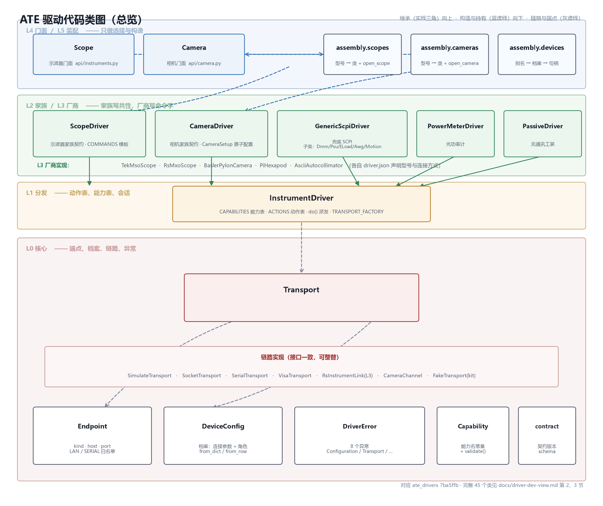
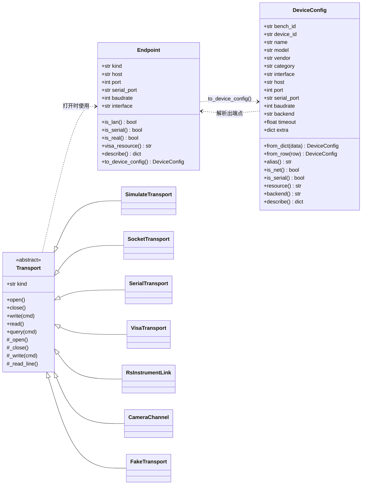
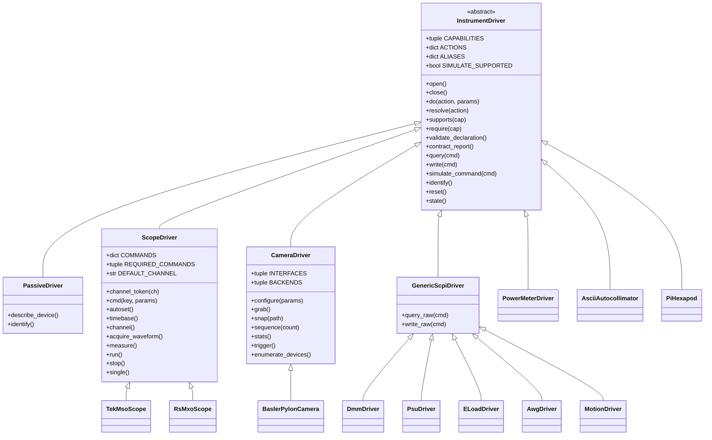
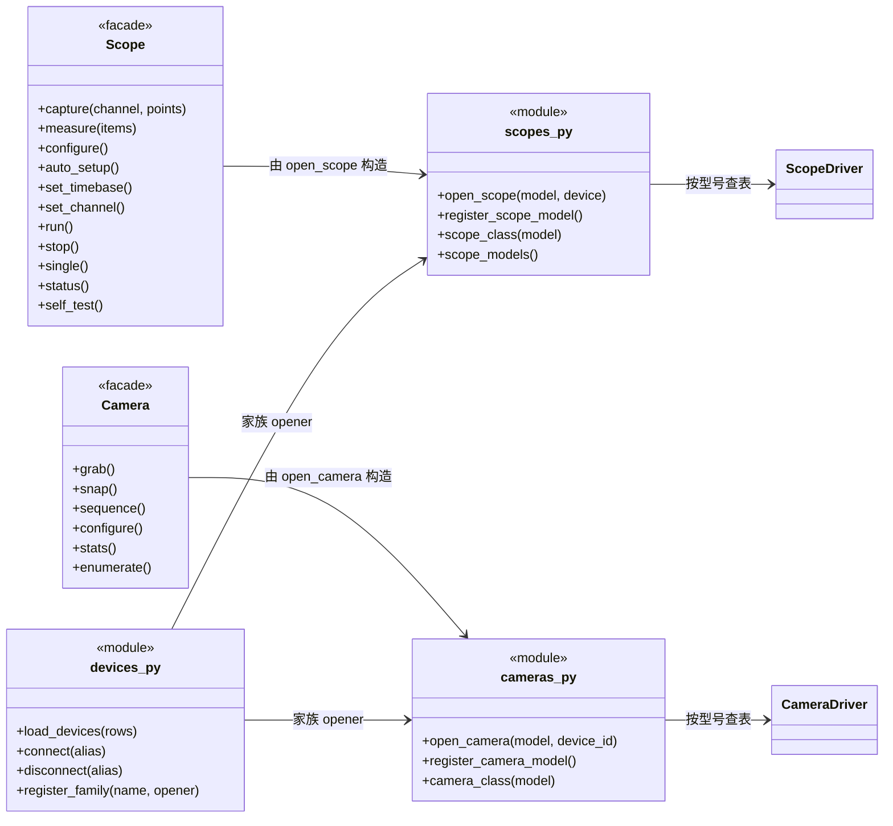

# 驱动开发视图

> 面向**维护者**的代码结构说明：每一层有哪些文件、每个类负责什么、谁依赖谁、改动会牵动哪里。
>
> 设计意图与不变式见 [`sdk/docs/design.md`](../sdk/docs/design.md)；新增一款仪器的操作步骤见
> [`sdk/docs/new-family-guide.md`](../sdk/docs/new-family-guide.md)。本文只讲**代码长什么样**。
>
> 对应提交 `7ba5ffb`，2026-11-04。

---

## 0. 一页速览

### 0.1 规模

| 层 | 目录 / 文件 | 文件数 | 行数 | 类数 |
| --- | --- | ---: | ---: | ---: |
| 装配层 L5 | `assembly/` | 4 | 887 | 2 |
| 门面层 L4 | `api/` · `__init__.py` | 4 | 861 | 2 |
| 家族层 L2 | `families/` | 7 | 2038 | 16 |
| 厂商层 L3 | `vendors/` | 12 | 1196 | 6 |
| 分发层 L1 | `base.py` | 1 | 371 | 2 |
| 核心层 L0 | `core/` | 7 | 1521 | 16 |
| 工具与自检 | `kit/` · `demos/` | 7 | 1391 | 1 |
| **合计** | | **42** | **8265** | **45** |

45 个类里，真正需要**继承**的只有 4 个：`InstrumentDriver`、`ScopeDriver`、`CameraDriver`、
`GenericScpiDriver`。其余是数据类（`Endpoint`、`DeviceConfig`、`Waveform`……）、链路实现
（`Transport` 的 7 个子类）和异常（8 个）。

### 0.2 三条铁律

| # | 铁律 | 违反的后果 | 谁能发现 |
| --- | --- | --- | --- |
| 1 | 依赖**只能向下**：`api → assembly → families → base → core` | 循环导入、改一处崩一片 | `kit/conformance.py` c15 + 人工 review |
| 2 | 厂商 SDK **只能出现在 `vendors/`** | 换个品牌就要改核心层，驱动全被绑死 | c15 三方导入白名单 |
| 3 | **没有静默回退**：型号未登记、链路打不开、能力未声明 → 抛类型化异常 | 现场故障被"看起来能用"掩盖 | c09 类型化错误 + c03 能力声明 |

### 0.3 一次调用的路径（先建立直觉）

```
用例            scope.capture("CH1")                     ← L4 门面，命令字不外露
                │
门面            Scope.capture → self._driver.do("scope.acquire_waveform", ...)
                │
分发            InstrumentDriver.do → resolve(action) → 方法 → self.query(":WAV:SOUR ...")   ← L1
                │
家族            ScopeDriver.acquire_waveform → self.cmd("waveform_set") → ":WAV:SOUR {channel}"  ← L2 只调表
                │
链路            Transport.query(cmd) → SocketTransport / VisaTransport / SimulateTransport     ← L0
                │
厂商            TekMsoScope / RsMxoScope 覆写 COMMANDS 表，把通用占位符换成自家命令字        ← L3
```

命令字出现在两处：`ScopeDriver.COMMANDS` 的值（L2 的**表**）和 `vendors/*/driver.py` 的**覆写**（L3）。
L2 不写死品牌名，L0 不认识任何品牌——这是整个结构能扩展的前提。

---

## 1. 代码结构

### 1.1 目录树

```
sdk/ate_drivers/
├── __init__.py                        216   公开契约（唯一的对外入口，其余都是内部）
│
├── core/                              L0 核心层：不依赖 anything
│   ├── __init__.py                     58   统一重导出
│   ├── errors.py                       66   8 个异常类
│   ├── contract.py                    119   契约版本、结果 schema、冻结动作、弃用装饰器
│   ├── capabilities.py                137   能力名常量表 + 校验
│   ├── endpoint.py                    381   Endpoint + 连接方式白名单 + 端点解析
│   ├── models.py                      166   DeviceConfig（设备档案）
│   └── transport.py                   594   Transport 基类 + 7 个链路实现
│
├── base.py                            371   L1 分发层：InstrumentDriver、PassiveDriver
│
├── families/                          L2 家族层：只写「家族共性」，不写品牌
│   ├── __init__.py                     37
│   ├── scope.py                       561   ScopeDriver + 4 个数据类
│   ├── camera.py                      768   CameraDriver + 3 个数据类
│   └── generic/
│       ├── __init__.py                 28
│       ├── scpi.py                    466   GenericScpiDriver + DMM/PSU/ELoad/AWG/Motion
│       ├── power_meter.py             161   PowerMeterDriver
│       └── util.py                     17   小工具
│
├── vendors/                           L3 厂商层：唯一允许 import 三方 SDK 的地方
│   ├── tektronix_mso/                  94   TekMsoScope（覆写 COMMANDS + 仿真信号）
│   ├── rohde_schwarz_mxo/
│   │   ├── driver.py                  232   RsMxoScope
│   │   └── rs_link.py                 126   RsInstrumentLink（R&S 官方库链路）
│   ├── basler_pylon/driver.py         371   BaslerPylonCamera
│   ├── pi_hexapod/driver.py           171   PiHexapod（六足台）
│   └── autocollimator_ascii/driver.py 134   AsciiAutocollimator（自准直仪）
│
├── assembly/                          L5 装配层：只做「选择与构造」
│   ├── __init__.py                     53
│   ├── scopes.py                      285   示波器注册表 + open_scope
│   ├── cameras.py                     234   相机注册表 + open_camera
│   └── devices.py                     315   设备簿：别名 → 档案 → 句柄
│
├── api/                               L4 门面层：给用例的稳定面孔
│   ├── __init__.py                     17
│   ├── instruments.py                 405   Scope
│   └── camera.py                      223   Camera
│
├── kit/                               工具：装包门禁与自检，不参与运行
│   ├── registry.py                    300   driver.json 装载、扫描、型号解析
│   ├── conformance.py                 523   19 项上架门禁
│   ├── cli.py                         317   命令行：scan / check / list
│   └── fake.py                         83   FakeTransport（单测用假链路）
│
└── demos/                             示例
    └── capability_demo.py             135
```

### 1.2 依赖规则

每一层只许依赖**它下面**的层，横向依赖一律禁止（`families/scope.py` 不许 import `families/camera.py`）。

| 从 \ 到 | core | base | families | vendors | assembly | api | kit |
| --- | :---: | :---: | :---: | :---: | :---: | :---: | :---: |
| **core** | — | ✗ | ✗ | ✗ | ✗ | ✗ | ✗ |
| **base** | ✓ | — | ✗ | ✗ | ✗ | ✗ | ✗ |
| **families** | ✓ | ✓ | 同层 ✗ | ✗ | ✗ | ✗ | ✗ |
| **vendors** | ✓ | ✓ | ✓ | 同层 ✗ | ✗ | ✗ | ✗ |
| **assembly** | ✓ | ✓ | ✓ | ✓ | 同层 ✗ | ✗ | ✗ |
| **api** | ✓ | ✓ | ✓ | 间接 | ✓ | 同层 ✗ | ✗ |

`api/` 不直接 import `vendors/`：门面只认 `InstrumentDriver` / `ScopeDriver` 这类抽象，
具体品牌由 `assembly/` 在构造时选好。

### 1.3 门禁怎么守住结构

结构不能靠自觉，`kit/conformance.py` 的 19 项检查里有两项专管这件事：

| 检查 | 管什么 | 实现 |
| --- | --- | --- |
| `c15_no_third_party_imports` | 驱动包顶层不许 import 三方库 | AST 遍历 `import`，白名单 `OPTIONAL_RUNTIME = ("serial","pyvisa","pypylon","numpy","RsInstrument")` 仅允许在函数内惰性导入 |
| `c18_connection_declared` | `driver.json` 的连接方式必须落在家族白名单内 | `endpoint.interfaces_for(family)` + `normalize_interface_kind()` |

跑法：

```bash
python -m ate_drivers.kit.cli check --pkg sdk/ate_drivers/vendors/tektronix_mso
```

---

## 2. 类图

下面三张 Mermaid 图按层拆开画，逐类的职责见第 3 节。文件渲染器不支持 Mermaid 时看位图版：



### 2.1 图 A · 数据与链路（L0）



**读图要点**：`Transport` 的 7 个子类接口完全一致——这是「换链路不改驱动」的全部秘密。
`RsInstrumentLink` 虽在 `vendors/`，但它实现的是同一个 `Transport` 接口，所以能整替。

### 2.2 图 B · 驱动继承树（L1 → L2 → L3）



**读图要点**：

* 左侧四条分支对应四类扩展动机——示波器（要波形语义）、相机（要图像语义）、通用 SCPI
  （只要命令通）、单件设备（连协议都懒得抽象，`PiHexapod` 这类）。
* `PassiveDriver` 挂在 `InstrumentDriver` 下而不是另起炉灶，是为了让「夹具、探针组」也能进
  同一张设备表、同一套 action 协议。
* 继承深度**最多 3 层**（`InstrumentDriver → GenericScpiDriver → DmmDriver`），再深就该抽家族层了。

### 2.3 图 C · 装配与门面（L4 / L5）



### 2.4 对象图：`open_scope("MSO54", host=...)` 之后内存里有什么

```
Scope  (api/instruments.py, L4 门面)
 ├─ .model      = "MSO54"
 ├─ .vendor     = "Tektronix"
 ├─ .endpoint   = Endpoint(kind="LAN", host="192.168.10.41", port=4000)     ← L0
 └─ ._driver    = TekMsoScope(cfg=DeviceConfig, mode="real")                ← L3
      ├─ .cfg        = DeviceConfig(...)                                    ← L0
      ├─ .transport  = SocketTransport(endpoint)                            ← L0
      ├─ .COMMANDS   = {"timebase_set": ":HOR:SCA {scale:g}", ...}          ← 该型号的命令表
      └─ .ACTIONS    = {"scope.acquire_waveform": "acquire_waveform", ...}   ← 继承自 ScopeDriver
```

门面持有驱动、驱动持有链路、链路持有端点——**单向持有，没有回指**。所以任何一个都能单独
替换或单独测试。

---

## 3. 类清单与职责

按层自下而上。每张表最后一列「不能做什么」是维护时的红线，改动前先读它。

### 3.1 核心层 L0 · `core/`

这一层的唯一职责是**把概念定义清楚**：什么是端点、什么是档案、什么是能力、什么是链路。
它不认识任何仪器，也不认识任何品牌。

#### 3.1.1 异常家族 `core/errors.py`

`DriverError` 是所有异常的根，携带 `message` + `detail` + `context`，`to_dict()` 直接进结果协议
的 `error` 字段——所以**异常本身也是返回值的一部分**，不能随手 `raise ValueError`。

| 类 | 何时抛 | 调用方怎么处理 | 不能做什么 |
| --- | --- | --- | --- |
| `DriverError` | 其他驱动异常的根 | 只捕获它就能兜住全部 | 不要直接抛它，抛具体子类 |
| `ConfigurationError` | 缺 IP / 端口 / 串口，参数互斥 | 报配置错误，**不要重试** | 不要用它表示链路故障 |
| `DriverNotFound` | 型号未登记、设备别名不存在 | 报驱动缺失，**不要兜底猜** | 不要在这里偷偷换别的驱动 |
| `TransportError` | 连不上、写失败、串口打不开 | 可切链路或报硬件故障 | 不要吞掉只打印日志 |
| `DriverTimeout` | 读写超时（`TransportError` 子类） | 可重试 | 不要与链路断开混为一谈 |
| `ProtocolError` | 应答无法解析、字段缺失 | 记日志 + 报仪器异常 | 不要静默返回空值 |
| `UnsupportedCapability` | 驱动未声明该能力 | 调用前先 `supports()` 判断 | 不要用 `NotImplementedError` 代替 |
| `ContractMismatch` | 契约版本不兼容 | 加载阶段即拒绝 | 不要运行时打补丁 |

#### 3.1.2 `Endpoint` · `core/endpoint.py`

一条链路的**端点描述**——只回答「连哪儿、怎么连」，不负责连。

| 项 | 内容 |
| --- | --- |
| 属性 | `kind`（只取 `LAN` / `SERIAL`）、`interface`、`host`、`port`、`serial_port`、`baudrate` |
| 方法 | `is_lan()` / `is_serial()` / `is_real()` / `visa_resource()` / `describe()` / `to_device_config()` |
| 谁在用 | `Transport` 打开时读它；`open_scope` 用它判定真机 / 仿真 |
| 红线 | **不许放命令、不许放超时策略**——超时属于驱动或链路，不属于端点 |

同文件还定义了两条**连接方式白名单真源**（其它模块一律从这里取，不许自己再写一份）：

| 符号 | 作用 |
| --- | --- |
| `SUPPORTED_INTERFACES` | 全量连接方式 |
| `FAMILY_INTERFACES` | 按家族细分：`{"camera": ("USB","USB3","GIGE","GIGE-V","CAMERALINK")}` |
| `interfaces_for(family)` | 未登记家族回落全量表 |
| `normalize_interface_kind(value, allowed)` | 先走别名表（`LAN`/`SERIAL`），再在 `allowed` 内去非字母数字比对 |
| `endpoint_from(cfg, ...)` | 档案 → 端点 |
| `visa_resource_for(...)` | 拼 `TCPIP0::…::SOCKET` / `ASRL6::INSTR` |

#### 3.1.3 `DeviceConfig` · `core/models.py`

一台设备的**档案**：连接参数 + 角色 + 超时 + 厂商扩展位。与数据库 `device_registry` 一行一一对应。

| 项 | 内容 |
| --- | --- |
| 构造 | `from_dict()`、`from_row()`（`sqlite3.Row` 直接吃） |
| 派生 | `alias()`（`device_id` 优先，回落 `name`）、`is_net()`、`is_serial()`、`resource()`、`visa_resource()`、`backend()`、`transport_kind()`、`describe()` |
| 扩展位 | `extra: dict` —— 厂商私有参数（如 `extra.rsinstrument = "off"`）都放这里，**不许加字段** |
| 谁在用 | 全层都吃它；`InstrumentDriver.__init__` 的第一个参数就是它 |
| 红线 | 不许出现业务语义（什么算通过、该采几个点），那属于用例或驱动 |

#### 3.1.4 `Capability` · `core/capabilities.py`

能力名**常量表**（纯常量类，无实例）。驱动声明 `CAPABILITIES`、用例按能力判断，
全部走这里的字符串，禁止手打魔法字符串。

| 项 | 内容 |
| --- | --- |
| 内容 | `IDENTIFY` / `RESET` / `STATE` / `SCOPE_*` / `CAMERA_*` / `PASSIVE_*` 等 |
| 配套函数 | `is_known(cap)`、`matches(pattern, cap)`（支持 `scope.*` 通配）、`validate(declared, family)` |
| 厂商扩展 | 前缀 `vendor.`，家族层不认识，只做透传 |
| 谁在用 | `InstrumentDriver.require()` / `supports()`；`conformance` c03 / c04 |

#### 3.1.5 `Transport` 家族 · `core/transport.py`

链路的**唯一抽象**。四个受保护方法 `_open/_close/_write/_read_line` 由子类实现，
四个公开方法 `open/close/write/read/query` 由基类管状态——子类**不许覆写公开方法**。

| 类 | 载体 | 关键点 | 谁在用 |
| --- | --- | --- | --- |
| `Transport` | 抽象 | `kind` 标识链路类型；`query()` = `write` + `read` 一体 | 所有驱动 |
| `SimulateTransport` | 内存 | 把命令交给 `handler(command)`，即驱动的 `simulate_command` | 仿真模式、全部单测、19 项门禁 |
| `SocketTransport` | TCP raw socket | VXI-11 / raw socket；产线最常用 | `LAN` 真机 |
| `SerialTransport` | RS-232/485/USB 转串口 | 与网口**同一套接口**，业务代码零差异 | `SERIAL` 真机 |
| `VisaTransport` | pyvisa | 网口与串口共用一个会话；`backend="visa"` 时选中 | 需要 VISA 属性的场合 |
| `CameraChannel` | 无 | 相机不跑文本协议，这条链路只把动作记进日志 | `CameraDriver` 的 `self.transport` |
| `RsInstrumentLink` | R&S 官方库 | 只有写读一体，`_read_line()` 直接抛 `ProtocolError` | `RsMxoScope` 真机 |

| 红线 | 说明 |
| --- | --- |
| `core/transport.py` 不许 import 任何厂商 SDK | 否则全部驱动被单一品牌绑死 |
| 打不开就报错，不许静默换链路 | 与「无静默回退」一致；换链路由调用方显式决定 |
| 不许在 `Transport` 里做参数转换 | 单位换算、枚举映射属于 L3 |

#### 3.1.6 `core/contract.py`（无类）

契约的**唯一真源**：`CONTRACT_NAME = "ate.driver.api"`、`API_VERSION = "1.2"`、
`RESULT_SCHEMA`、`WAVEFORM_SCHEMA`、`MANIFEST_SCHEMA`、`FROZEN_ACTIONS`。

| 函数 | 作用 |
| --- | --- |
| `check_compatible(driver_api, platform_api)` | 装载阶段做版本闸门 |
| `deprecated(since, remove_in, replacement)` | 装饰器，标记待删动作 |
| `action_of(cap)` / `capability_of(action)` | 能力名与动作名互转 |
| `describe_contract()` | 打印当前契约，`cli info` 用 |

### 3.2 分发层 L1 · `base.py`

#### 3.2.1 `InstrumentDriver`

**所有驱动的基类**，也是「动作分发」的唯一实现处。它把三类东西绑在一起：

| 关注点 | 机制 |
| --- | --- |
| 能力声明 | `CAPABILITIES`（元组）+ `supports()` / `require()` |
| 动作派发 | `ACTIONS`（`能力名 → 方法名`）+ `do()` / `resolve()` / `normalize_action()` |
| 会话与链路 | `open()` / `ensure_open()` / `close()` / `protect_on_close()`；`TRANSPORT_FACTORY` 钩子供 L3 换链路 |

| 关键成员 | 说明 |
| --- | --- |
| `SIMULATE_SUPPORTED = True` | 家族不支持仿真时置 `False`，仿真请求会直接报错而不是假装成功 |
| `TRANSPORT_FACTORY = None` | **通用钩子**，L3 可注入自定义工厂（R&S 用它接 RsInstrument）；核心层不认识品牌 |
| `do(action, **params)` | 用例/门面唯一入口；内部 `resolve` → 方法 → 结果包装成 `RESULT_SCHEMA` |
| `validate_declaration()` | 自查：`ACTIONS` 里每个方法是否真实存在、`CAPABILITIES` 是否都有动作 |
| `contract_report()` | 输出该驱动的契约快照，门禁与 `cli` 都用它 |
| `simulate_command(command)` | 仿真默认实现；家族按需覆写成有意义的假数据 |

| 红线 | 说明 |
| --- | --- |
| 不许在 `base.py` 写任何仪器语义 | 这里只有分发与会话 |
| 不许把 `do()` 做成字符串 eval 式派发 | 必须查 `ACTIONS` 表，未知动作报 `UnsupportedCapability` |

#### 3.2.2 `PassiveDriver`

被动设备（夹具、探针组、负载工装）：**只登记信息，不做通讯**。

| 项 | 内容 |
| --- | --- |
| 能力 | `identify` / `reset` / `state` / `passive.describe` |
| 特有方法 | `describe_device()` —— 返回该工装的静态描述 |
| 存在意义 | 让「不需要通讯的工装」也能进同一张设备表、走同一套 action 协议，而不是在用例里硬编码 |
| 红线 | 不许悄悄建链路；它连 `transport` 都不该有 |

### 3.3 家族层 L2 · `families/`

家族层写「这一类仪器的共性」，**不写任何品牌、型号、SCPI 命令字**。命令字以**占位符表**
的形式存在（`COMMANDS = {"timebase_set": ":HOR:SCA {scale:g}"}`），由 L3 覆写。

#### 3.3.1 `ScopeDriver` · `families/scope.py`

数字示波器家族契约。它是全仓库最典型的「模板方法」实现：**动作骨架在 L2，命令字在 L3**。

| 项 | 内容 |
| --- | --- |
| 声明 | `CAPABILITIES`（identify / reset / state / scope.autoset / scope.timebase / scope.channel / scope.acquire / scope.measure / scope.run / scope.stop / scope.single） |
| 动作表 | `ACTIONS`（能力名 → 方法名）、`ALIASES`（`idn` → `identify` 等旧名映射） |
| 命令模板 | `COMMANDS`（`{channel}` / `{scale:g}` 占位）、`REQUIRED_COMMANDS`（缺一条就上不了架） |
| 约定 | `DEFAULT_CHANNEL = "CH1"`、`PREAMBLE_FIELDS`（前导码字段顺序） |
| 主要方法 | `channel_token()` / `cmd(key, **params)` / `missing_commands()` / `autoset()` / `timebase()` / `channel()` / `acquire_waveform()` / `measure()` / `run()` / `stop()` / `single()` / `state()` |
| 仿真 | `_sim_signal()` 造波形、`simulate_command()` 应答假命令——**仿真目的是让用例在无硬件时也能跑通** |
| 谁在用 | `api/instruments.py` 的 `Scope`；`TekMsoScope` / `RsMxoScope` 继承并覆写 `COMMANDS` |

| 红线 | 说明 |
| --- | --- |
| 文件里不许出现 `:` 开头的 SCPI 字 | 出现即被单一品牌绑死（唯一例外是作为**模板值**的占位串） |
| 不许出现品牌名、型号名 | 型号识别属于 `assembly/` 与 `vendors/` |

四个数据类（都是不可变的「配置面 / 结果面」）：

| 类 | 职责 | 关键点 |
| --- | --- | --- |
| `TimebaseSetup` | 时基：`scale_s_per_div` / `divisions` / `offset_s` | 单位一律 SI 秒，不用 ms/us 混写；`window_s()` 算总窗口 |
| `ChannelSetup` | 通道：`enabled` / `scale_v_per_div` / `offset_v` / `coupling` | V/div 与 V 不混用 |
| `Waveform` | 一段采样：`samples`（V）+ `x_start_s` + `x_incr_s` | 时间轴由起点与步长唯一确定，不存 x 数组 |
| `Measurement` | 一个测量项：`kind`（固定枚举）+ `value` + `unit`（必填） | `unit` 缺失即上不了架（c08） |

#### 3.3.2 `CameraDriver` · `families/camera.py`

工业相机家族基类。与示波器的关键差异：**相机不跑文本协议**，所以没有 `COMMANDS` 表，
配置面是一个结构化的 `CameraSetup` 对象而不是一串命令。

| 项 | 内容 |
| --- | --- |
| 声明 | `INTERFACES = ("USB","GIGE")`、`BACKENDS = ("native",)` |
| 动作表 | 10 条：`identify` / `reset` / `state` / `camera.enumerate` / `camera.configure` / `camera.grab` / `camera.snap` / `camera.sequence` / `camera.stats` / `camera.trigger` |
| 主要方法 | `enumerate_devices()` / `configure(**params)` / `grab()` / `snap(path, format)` / `sequence(count, interval_ms)` / `stats(region)` / `trigger()` |
| 模板方法 | `_open_device` / `_close_device` / `_enumerate` / `_apply(setup)` / `_fetch(setup, timeout_ms)` / `_save(path, pixels, fmt)` —— L3 只实现这几个 |
| **原子配置** | `configure()` 走「复制当前 `setup` → `merge` → `validate` → 提交 → 只有真机才 `_apply`」，中途校验失败不留半套参数 |
| 谁在用 | `api/camera.py` 的 `Camera`；`BaslerPylonCamera` 继承 |

| 红线 | 说明 |
| --- | --- |
| `configure()` 不许直接改 `self.setup` | 必须走「候选副本 + 校验 + 提交」，否则失败后现场回到未知状态 |
| 仿真分支不许调用 `_apply` | 仿真没有设备可配，调用会误导排障 |

| 数据类 | 职责 |
| --- | --- |
| `CameraSetup` | 采集参数（分辨率、偏移、像素格式、曝光、增益、帧率、触发、超时、仿真图案）。带 `validate()` / `to_dict()` / `from_dict()` / `merge()` |
| `FrameInfo` | 一帧的元数据（时间戳、序号、尺寸），与统计量分开，报告可直接引用 |
| `CameraChannel` | 相机的「假链路」：记录动作供排障，不承载协议 |

#### 3.3.3 `families/generic/` · 六个不建家族层的类型

这六类动作数 ≤ 6，**直接继承 `InstrumentDriver` 或 `GenericScpiDriver`**，不为它们单独建
家族层——多一层抽象只增加跳转。

| 类 | 文件 | 职责 | 关键动作 |
| --- | --- | --- | --- |
| `GenericScpiDriver` | `generic/scpi.py` | 兜底驱动：任何 SCPI 仪器都能连上发命令，不做专用解析 | `query_raw` / `write_raw` |
| `DmmDriver` | 同上 | 数字万用表（Fluke 8846A 及通用 SCPI 表） | `measure_dc_voltage` / `_dc_current` / `_resistance` / `_ac_voltage` / `_frequency` |
| `PsuDriver` | 同上 | 可编程直流电源（ITECH IT6300 及同类） | `set_voltage` / `set_current` / `output_on` / `output_off` / `measure_*` |
| `ELoadDriver` | 同上 | 可编程电子负载（ITECH IT8500 及同类） | `set_current` / `set_mode` / `input_on` / `input_off` / `measure_*` |
| `AwgDriver` | 同上 | 波形发生器（Keysight 33500B 及同类） | `set_waveform` / `set_frequency` / `set_amplitude` / `output_on` |
| `MotionDriver` | 同上 | 读头转速控制盒（串口 ASCII） | `handshake` / `set_speed` / `read_speed` / `home` / `stop` |
| `PowerMeterDriver` | `generic/power_meter.py` | 光功率计：波长、平均次数、量程、归零、读功率 | `set_wavelength` / `set_average` / `zero` / `read_power` |

| 红线 | 说明 |
| --- | --- |
| `GenericScpiDriver` 不是「万能驱动」 | 它只保证能发命令；要解析值、要单位、要结果 schema，必须建专用类 |
| 六类的 `simulate_command()` 必须给出**量纲正确**的假数据 | 否则仿真跑通、真机崩，等于没测 |

### 3.4 厂商层 L3 · `vendors/`

唯一允许 `import` 三方 SDK 的地方。每个型号一个包，包内固定三件套：
`driver.py`（驱动类）、`driver.json`（manifest）、`__init__.py`（导出）。

| 类 | 型号 / 载体 | 覆写什么 | 依赖 | 红线 |
| --- | --- | --- | --- | --- |
| `TekMsoScope` | Tektronix MSO5/6 系列，LAN/SERIAL | `COMMANDS` 表、`_sim_signal`、`simulate_command` | 无（纯 SCPI） | 不许改动作集合，只改命令字 |
| `RsMxoScope` | R&S MXO4/5，LAN/SERIAL | `COMMANDS`、`_decode_preamble` / `_decode_header`、`acquisition` | 可选 `RsInstrument` | 仿真分支**不许**走厂家库 |
| `RsInstrumentLink` | 链路层 | `Transport` 的四个受保护方法 | `RsInstrument`（惰性导入） | 不许登记成第三种 backend；打开失败必须报错不回退 |
| `BaslerPylonCamera` | Basler acA/boA 系列，USB/GIGE | `_open_device` / `_apply` / `_fetch` / `_save` / `_enumerate` | `pypylon`（惰性） | 不许把 pylon 类型泄漏到家族层 |
| `PiHexapod` | PI 六足台，LAN/SERIAL | `_send` / `move` / `read_position` / `home` / `set_servo` | 无 | 不许吞掉位置越界错误 |
| `AsciiAutocollimator` | 自准直仪，SERIAL | `_send` / `measure_angle` / `zero` / `set_mode` | 无 | 角度单位必须显式（deg/arcsec） |

`RsInstrumentLink` 值得单说，因为它是**唯一一个在 L3 实现 L0 接口**的类：

```
RsMxoScope.TRANSPORT_FACTORY = staticmethod(rs_transport)
        ↓ 真机 + 装了 RsInstrument
RsInstrumentLink(Transport)   ← 接口与 SocketTransport 完全一致，可整替
        ↓ 打不开
TransportError（附运维指引：extra.rsinstrument = off 可回退原生 SCPI）
```

### 3.5 门面层 L4 · `api/`

#### 3.5.1 `Scope` · `api/instruments.py`

一台示波器的**顶层对象**，用例只碰它。存在的意义是把「型号 / 端点 / 后端」这些构造细节
收进构造函数，让方法签名保持领域语言（`volts_per_div`、`seconds_per_div`），命令字一律不外露。

| 分组 | 成员 |
| --- | --- |
| 元信息 | `model` / `vendor` / `label` / `interface` / `interfaces` / `interface_kind` / `backend` / `backends` / `visa_resource` / `mode` / `simulated` / `metadata` / `endpoint` |
| 生命周期 | `connect()` / `close()` / `__enter__` / `__exit__` |
| 配置 | `auto_setup()` / `set_timebase()` / `set_channel()` / `configure()` |
| 采集 | `capture(channel, points)` / `measure(items)` / `status()` |
| 运行态 | `run()` / `stop()` / `single()` |
| 自检 | `identity()` / `self_test()` / `supported_measurements()` |

| 红线 | 说明 |
| --- | --- |
| 门面不许出现 `self._driver.query(...)` 之外的直连命令 | 命令字只在 L2/L3 |
| 门面方法名用领域术语，不用 SCPI 术语 | `set_timebase` 而不是 `hor_scale` |

#### 3.5.2 `Camera` · `api/camera.py`

与 `Scope` 同构：`grab` / `snap` / `sequence` / `configure` / `stats` / `enumerate` /
`identity` / `reset` / `setup`（当前配置快照）/ 上下文管理器。差异在于返回值——
相机的 `grab` 返回的是像素数组 + `FrameInfo`，不是波形对象。

### 3.6 装配层 L5 · `assembly/`

只做三件事：**查表、构造、缓存**。不做协议、不做参数转换、不碰数据库。

| 模块 | 职责 | 关键符号 |
| --- | --- | --- |
| `scopes.py` | 示波器注册表 | `open_scope` / `scope_class` / `scope_entry` / `scope_models` / `scope_entries` / `scope_aliases` / `scope_vendors` / `register_scope_model` / `register_scope_driver` / `unregister_scope_driver` / `scope_self_check` / `scope_describe` |
| `cameras.py` | 相机注册表（与上者同构） | `open_camera` / `camera_class` / `camera_entry` / `camera_models` / `camera_entries` / `camera_aliases` / `camera_vendors` / `register_camera_model` / `register_camera_driver` / `unregister_camera_driver` / `camera_self_check` / `camera_describe` |
| `devices.py` | 设备簿：别名 → 档案 → 句柄 | `load_devices` / `connect` / `disconnect` / `disconnect_all` / `handle_of` / `handles` / `device_config` / `device_aliases` / `register_device` / `register_family` / `unload_devices` |

内部两个私有类，都不是给外部用的：

| 类 | 职责 | 说明 |
| --- | --- | --- |
| `_Reg`（`scopes.py`） | 一条注册项：型号 → 驱动类 + 厂商 + 连接方式 | 型号归一化后做**精确匹配**，不做模糊/打分 |
| `_Entry`（`cameras.py`） | 同上，相机版 | 与 `_Reg` 对称；相机的 `models` 是列表 |

| 红线 | 说明 |
| --- | --- |
| 不许打分、不许模糊匹配、不许兜底驱动 | 型号不认识就报 `DriverNotFound` |
| `devices.py` 不许连数据库 | 档案由后端灌入，SDK 只管内存里的簿子 |
| 家族 opener 签名固定 | `opener(cfg, *, mode, timeout, open)`，新家族照此实现 |

### 3.7 工具与自检 · `kit/`

不参与运行，只服务于「装包门禁」与「开发自测」。

| 文件 | 内容 | 用途 |
| --- | --- | --- |
| `registry.py` | `MANIFEST_NAME` / `REQUIRED_FIELDS` / `OPTIONAL_DEFAULTS` / `load_manifest` / `scan_dir` / `resolve_entry` / `resolve_spec` / `merge_specs` / `model_conflicts` / `describe_registry` | 读 `driver.json`、扫描驱动包、把型号解析到具体 spec |
| `conformance.py` | 19 个 `c01`~`c19` + `run_conformance` / `format_report` | 上架门禁：能力可实现、结果 schema、单位、错误类型、会话生命周期、拆解安全、确定性、实例隔离、别名合法、三方导入、弃用标注、型号派发、连接声明、后端声明 |
| `cli.py` | `scan` / `check` / `list` / `info` 子命令 | 命令行入口 |
| `fake.py` | `FakeTransport` | 单测用假链路：`expect()` / `expect_re()` / `fail()` 预设应答与故障，**不依赖任何硬件** |

`FakeTransport` 与 `SimulateTransport` 的区别：

| | `SimulateTransport` | `FakeTransport` |
| --- | --- | --- |
| 位置 | `core/transport.py`（产品代码） | `kit/fake.py`（测试工具） |
| 应答来源 | 驱动的 `simulate_command()` | 测试里写死的期望表 |
| 用途 | 无硬件跑真实用例 | 验证「某个命令发出去了、某条应答怎么解析」 |

---

## 4. 关键机制

### 4.1 一次动作从门面到命令字

```
scope.capture("CH1", points=2000)                      L4  api/instruments.py
  └─ self._driver.do("scope.acquire_waveform", channel="CH1", points=2000)
       ├─ normalize_action("scope.acquire_waveform")   L1  base.py：别名归一到标准动作名
       ├─ resolve(action)                              L1  查 ACTIONS → 方法名 "acquire_waveform"
       ├─ getattr(self, "acquire_waveform")(...)       L2  families/scope.py
       │    ├─ self.require(Capability.SCOPE_ACQUIRE)  未声明即 UnsupportedCapability
       │    ├─ self.cmd("waveform_set", channel="CH1") L2  从 COMMANDS 取模板 → ":WAV:SOUR {channel}"
       │    │    └─ 模板值由 L3 覆写：TekMsoScope.COMMANDS["waveform_set"] = ":DATA:SOURCE {channel}"
       │    └─ self.query(...)                         L0  Transport.query → 对应链路
       └─ 结果包成 {"ok", "schema", "device_id", "driver", "action", "value", "detail", "quality", ...}
```

三点必须记住：

1. **`ACTIONS` 是白名单**，不在表里的动作一律 `UnsupportedCapability`，不存在「猜一下试试」。
2. **`ALIASES` 只是历史兼容层**，新代码写标准动作名；旧名映射在 `FROZEN_ACTIONS` 里有登记。
3. **结果 schema 由 L1 统一包装**，家族方法只返回领域值（`Waveform` / `Measurement` / dict），
   不自己拼 `ok` 字段。

### 4.2 能力的三道闸

| 闸 | 位置 | 拦什么 |
| --- | --- | --- |
| 声明 | 类属性 `CAPABILITIES` | 驱动没声明就不许实现，`validate_declaration()` 自查 |
| 实现 | `conformance` c04 | 声明的每个能力必须有对应动作方法 |
| 调用 | `supports()` / `require()` | 调用方越界直接抛 `UnsupportedCapability`，不返回 None |

新增能力时**三处一起改**：`core/capabilities.py` 加常量 → 家族 `ACTIONS` 加映射 →
驱动实现方法。漏一处，门禁会拦（c03 / c04）。

### 4.3 仿真为什么是产品代码而不是测试桩

`SimulateTransport` 放在 `core/`，`simulate_command()` 写在各家族里，不是为了跑单测方便，
而是三个现实需求：

| 需求 | 靠什么满足 |
| --- | --- |
| 台架没到位时先把用例写完 | 用例在 `mode="simulate"` 下必须**语义正确**（单位对、量纲对、结果 schema 对） |
| 产线换机前的回归 | 同一份用例真机/仿真各跑一遍，差异只应在数值不在结构 |
| 上架门禁 | c06 要求「每个能力在仿真下都能返回合法结果」，跑不了就上不了架 |

因此家族里的 `_sim_signal()` 造的是**有物理意义的假波形**（正弦/方波/噪声，幅值频率可控），
不是随机数。改仿真数据前先想清楚：用例会不会因此变成「假通过」。

### 4.4 链路怎么选

选择逻辑集中在 `core/transport.py` 的 `make_transport()`，驱动不自己判断。

| 输入 | 结果 |
| --- | --- |
| `mode="simulate"` | `SimulateTransport`（与端点无关） |
| `backend="visa"` + 装了 pyvisa | `VisaTransport`（网口/串口共用会话） |
| `backend="socket"` 或 `auto` 且无 pyvisa | `SocketTransport`（LAN）/ `SerialTransport`（SERIAL） |
| `backend="auto"` + 有 pyvisa | `VisaTransport` |
| 驱动设了 `TRANSPORT_FACTORY` | 由该工厂决定（如 R&S 的 `rs_transport`，见 3.4） |

配套符号分居两个文件，别记错位置：

| 符号 | 所在 | 作用 |
| --- | --- | --- |
| `SUPPORTED_BACKENDS` / `DEFAULT_BACKEND` / `BACKEND_CHOICES` / `NATIVE` / `AUTO` / `VISA` | `core/endpoint.py` | 后端名与选择策略的常量 |
| `normalize_backend()` / `resolve_backend()` | `core/endpoint.py` | 归一化与「auto 该落哪个」 |
| `make_transport()` / `transport_class()` / `visa_available()` | `core/transport.py` | 真正造链路 |
| `set_visa_factory()` / `set_serial_factory()` | `core/transport.py` | **测试注入点**，生产代码不要调 |

**`TRANSPORT_FACTORY` 是唯一允许 L3 干预链路选择的口子**，且必须满足三条不变式：

1. `core/transport.py` 不认识它，只认 `Transport` 接口；
2. 打开失败**不静默回退**，抛 `TransportError` 并给运维指引；
3. 仿真模式不走厂商库。

### 4.5 设备簿与句柄缓存

```
后端/Runner                        SDK                      用例
  device_registry  ──rows──▶  load_devices()  ──▶  _CONFIGS[bench::alias]
                                                        │
                                            connect("scope_main")
                                                        │ 命中缓存？
                                                        ├─ 是 → 返回同一实例
                                                        └─ 否 → 家族 opener → 驱动 → 存入 _HANDLES
```

| 关注点 | 实现 |
| --- | --- |
| 三种身份 | 别名 `device_id` / 型号 `model` / 连接参数 `host·port·serial_port·interface` |
| 同型号多台 | 别名区分；`(bench_id, device_id)` 唯一 |
| 跨台架同名 | `connect(alias, bench_id=...)`；不指定则报 `ConfigurationError`，不猜 |
| 重连 | `connect(alias, refresh=True)` → 先 `disconnect` 再建 |
| 家族派发 | `category` / `role` / `extra.device_type` 判定，**已登记家族名优先** |
| 扩展 | `register_family("psu", opener)`，设备簿不认识具体家族 |

**SDK 不连数据库**：簿子只在内存，谁灌进来谁负责清理（`unload_devices`）。这是刻意设计——
让 SDK 能在任何进程里跑（后端、Runner、单测、CI），不背配置来源的锅。

### 4.6 `driver.json` 不参与运行

容易误解的一点：manifest **不在运行时生效**。它只在两个时刻被读：

| 时刻 | 谁读 | 干什么 |
| --- | --- | --- |
| 装包 / 上架 | `kit/registry.py scan_dir` + `conformance` | 校验字段、解析入口、跑 19 项门禁 |
| 后端启动 | `backend/drivers/discovery.py` | 扫目录、把型号与驱动类登记进注册表 |

运行期派发只看**内存注册表**（`assembly/scopes.py` 的 `_registry`，`dict[str, _Reg]`）。所以改了 `driver.json`
不重启、不重新扫描，运行行为不会变——这是排查「改了配置没生效」的第一条线索。

---

## 5. 扩展点一览

| 想做的事 | 改哪里 | 具体做法 | 别动 |
| --- | --- | --- | --- |
| 加一款同家族仪器（如新的 Tek 型号） | `vendors/<key>/` | 新建包：`driver.py` 继承家族基类、覆写 `COMMANDS`、`driver.json` 填型号、`__init__.py` 导出 | 家族层、核心层 |
| 加一个新家族（如源表 SMU） | `families/smu.py` + `assembly/smus.py` + `api/smu.py` | 照 `scope.py` 抄骨架；动作 ≤6 个则直接继承 `InstrumentDriver`，不建家族层 | 已有的家族 |
| 加一种链路（如 Modbus-TCP） | `core/transport.py` | 新增 `Transport` 子类，实现四个受保护方法；在 `make_transport` 里登记 | 驱动类 |
| 接厂商 SDK 的链路（如 RsInstrument） | `vendors/<key>/` | 在 L3 实现 `Transport` 子类 + 类属性 `TRANSPORT_FACTORY` | `core/transport.py` |
| 加一个新能力 | `core/capabilities.py` → 家族 `ACTIONS` → 驱动方法 | 三处同改，漏一处门禁拦 | 门面签名（尽量只加不改） |
| 加一个新设备类型进设备簿 | `assembly/devices.py` 调用 `register_family` | `opener(cfg, *, mode, timeout, open)` | 设备簿内部结构 |
| 加一条上架门禁 | `kit/conformance.py` | 写 `c20_xxx(ctx)`，加进 `CHECKS` 列表 | 已有 19 项的含义 |
| 加一个动作别名 | 家族 `ALIASES` + `core/contract.py FROZEN_ACTIONS` | 别名只增不删；删要走 `@deprecated` 流程 | 标准动作名 |

---

## 6. 新增一个驱动要碰的文件（清单）

以「新增一款同家族仪器」为例，按顺序做，每步都能单独验证：

| # | 文件 | 动作 | 验证方式 |
| --- | --- | --- | --- |
| 1 | `vendors/<key>/driver.py` | 继承家族基类，覆写 `COMMANDS` / `_apply` / `_fetch` / `simulate_command` | `python -c "from ... import X; print(X().contract_report())"` |
| 2 | `vendors/<key>/driver.json` | 7 个必填字段 + `models` / `interfaces` / `depends` | `kit.registry.load_manifest()` 能过 |
| 3 | `vendors/<key>/__init__.py` | 导出驱动类 | `import` 不报错 |
| 4 | 运行期注册点 | 在 `vendors/__init__.py` 或后端 `drivers/` 里 `register_scope_model(...)` | `assembly.scopes.scope_models()` 里能看到型号 |
| 5 | `tests/test_<key>.py` | 仿真跑通全部能力 + `run_conformance(...)["ok"]` | `pytest` |
| 6 | 门禁 | `python -m ate_drivers.kit.cli check --pkg vendors/<key>` | 19/19 |
| 7 | 文档 | 家族指南里补一行型号表 | 人工 |

第 4 步是最容易漏的：**manifest 里有型号 ≠ 注册表里有型号**。装包扫描（`scan_dir`）负责把
manifest 变成 spec，真正让 `open_scope("型号")` 能用的是注册表里那一条。少了它，门禁全过但
现场报 `DriverNotFound`。

---

## 7. 代码阅读路线

给第一次接触这套代码的人，按这个顺序读，两小时内能建立完整心智模型：

| 顺序 | 文件 | 读什么 | 大约 |
| --- | --- | --- | ---: |
| 1 | `core/errors.py` | 8 个异常，理解「错误也是返回值」 | 5 分钟 |
| 2 | `core/models.py` | `DeviceConfig` 是全局语汇 | 10 分钟 |
| 3 | `core/endpoint.py` | 端点与连接方式白名单 | 10 分钟 |
| 4 | `core/transport.py` | 只看 `Transport` 基类 + `SimulateTransport` | 15 分钟 |
| 5 | `base.py` | `ACTIONS` / `CAPABILITIES` / `do()` 三件套 | 20 分钟 |
| 6 | `families/scope.py` | 模板方法怎么把命令字留给 L3 | 25 分钟 |
| 7 | `vendors/tektronix_mso/driver.py` | 最短的完整驱动（94 行） | 10 分钟 |
| 8 | `api/instruments.py` | 门面怎样把构造细节收起来 | 15 分钟 |
| 9 | `assembly/scopes.py` | 型号 → 类的精确派发 | 10 分钟 |
| 10 | `kit/conformance.py` | 19 项门禁即「框架对驱动的全部要求」 | 20 分钟 |
| 11 | `assembly/devices.py` | 别名与句柄缓存 | 10 分钟 |
| 12 | `families/camera.py` | 另一个家族的形态差异（结构化配置 vs 命令表） | 20 分钟 |

读完 1~9 就能改驱动；10 决定你的驱动能不能上架；11~12 是按需。

---

## 附：本文与其它文档的分工

| 文档 | 回答什么 | 读者 |
| --- | --- | --- |
| **本文** | 代码长什么样、每个类干什么、改动牵动哪里 | 维护者、接手的人 |
| `sdk/docs/design.md` | 为什么这么分层、有哪些不变式 | 架构评审 |
| `sdk/docs/new-family-guide.md` | 新增家族的逐步操作 | 要做扩展的人 |
| `sdk/docs/user-guide.md` | 用例侧怎么用 `open_scope` / `connect` | 写用例的人 |
| `docs/architecture.md` | 系统级视角（后端、Runner、前端） | 全员 |

> 维护约定：本文的类清单与行号随代码走。结构性改动（加层、加家族、改依赖方向）请同步本文
> 第 1、2、3 节；纯实现改动不必更新。
