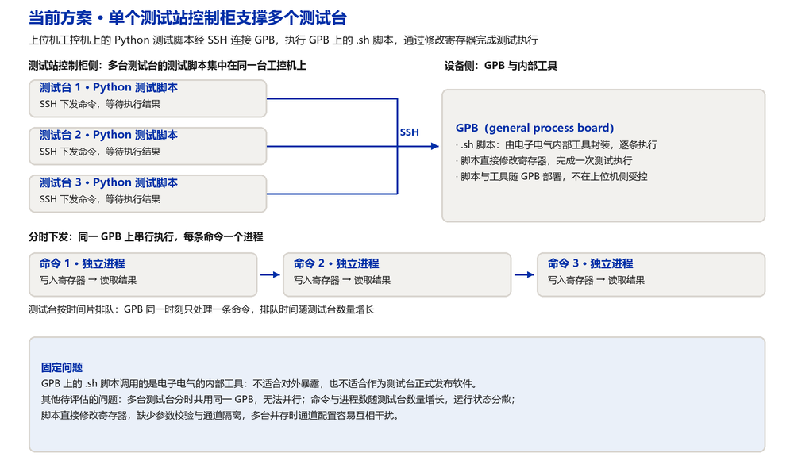
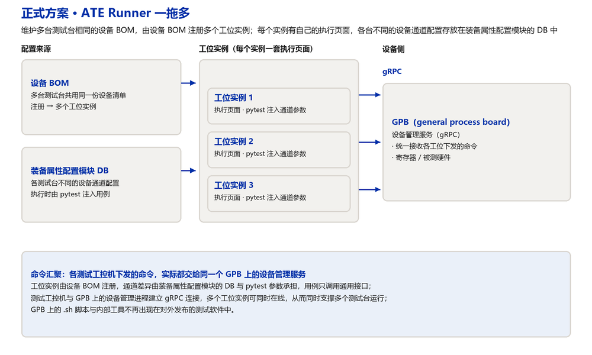
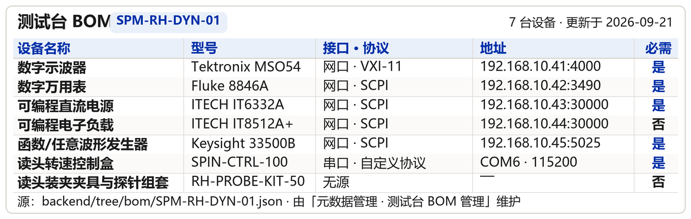
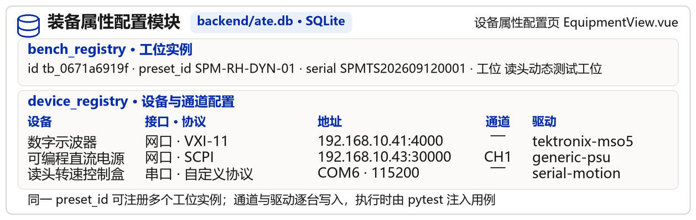

# 一拖多设计：单个测试站控制柜支撑多个测试台

提效需求与 GPB 的产能限制，使单个测试站控制柜需要连接同一个 GPB 并支撑多个测试台运行。本文分两部分：第一部分说明问题背景与当前做法及其风险，第二部分说明正式方案 ATE Runner 的一拖多机制。

## 一、问题背景

### 1.1 需求与约束

| 项 | 说明 |
| --- | --- |
| 提效需求 | 同一测试站控制柜下支撑多个测试台运行，提高工位利用率与产出 |
| GPB 产能限制 | GPB（general process board）的数量与内部资源有限，无法为每个测试台各配一块 |
| 由此产生的约束 | 单个控制柜需要连接同一个 GPB，并在该 GPB 上支撑多个测试台运行 |

### 1.2 当前方案

当前做法由上位机驱动机器上的 Python 测试脚本，经 SSH 连接 GPB，执行 GPB 上的 `.sh` 脚本，通过修改寄存器完成测试执行。一个测试站连接多个测试台时，分时向同一个 GPB 下发多条命令，每条命令对应一个进程。

| 环节 | 当前做法 |
| --- | --- |
| 命令下发 | 上位机工控机 PC 上的 Python 测试脚本，经 SSH 连接 GPB |
| 测试执行 | 执行 GPB 上的 `.sh` 脚本，脚本直接修改寄存器 |
| 多台支撑 | 分时向同一个 GPB 下发多条命令，命令之间串行执行，每条命令一个进程 |
| 版本与部署 | 脚本与内部工具随 GPB 部署，版本不在上位机侧受控 |

### 1.3 该方案可能存在的问题

| 编号 | 问题 | 性质 |
| --- | --- | --- |
| 1 | `.sh` 脚本调用的是电子电气的内部工具，不适合对外暴露，也不适合作为测试台正式发布软件 | 固定问题（已确认） |
| 2 | 多台测试台分时共用同一个 GPB：无法并行，排队时间随测试台数量增长 | 待评估 |
| 3 | 命令与进程数随测试台数量增长，运行状态与结果分散在各进程，缺少统一记录 | 待评估 |
| 4 | 脚本直接修改寄存器：缺少参数校验与通道隔离，多台并存时通道配置容易互相干扰 | 待评估 |

## 二、正式方案：ATE Runner 一拖多

### 2.1 机制

ATE Runner 维护多个测试台相同的设备 BOM，通过设备 BOM 将测试台注册为多个工位实例，每一个实例有自己的执行网页页面。各测试台不同的设备通道配置写在装备属性配置模块的 DB 数据库中。测试执行时通过 pytest 将这些参数传递给测试用例，测试用例与 GPB 上的设备管理进程建立 gRPC 连接；这些测试工控机下发的命令实际都发给了同一个 GPB 上的设备管理服务，由此达成同时支撑多个测试台的目的。

| 环节 | 做法 |
| --- | --- |
| 设备 BOM | 维护多个测试台相同的设备 BOM，多台共用同一份设备清单 |
| 工位实例 | 通过设备 BOM 将测试台注册为多个工位实例，每个实例有独立的执行网页页面与运行上下文 |
| 通道配置 | 各测试台不同的设备通道配置写入装备属性配置模块的 DB 数据库 |
| 参数注入 | 测试执行时通过 pytest 将通道配置等参数传递给测试用例 |
| 连接方式 | 测试用例与 GPB 上的设备管理进程建立 gRPC 连接 |
| 汇聚点 | 各测试工控机下发的命令，实际都发给了同一个 GPB 上的设备管理服务 |

上表六个环节各自对应页面上的一个图标：设备 BOM、工位实例、通道配置、参数注入、连接方式、汇聚点。以下两张取自 ATE Runner 的实际数据（只读导出，未作改写）：

| 实际数据 | 出处 | 页面上的读法 |
| --- | --- | --- |
| 测试台 BOM（7 台设备） | `backend/tree/bom/SPM-RH-DYN-01.json`，由元数据管理 · 测试台 BOM 管理维护 | 设备 BOM 是注册工位实例的依据，多台测试台共用同一份清单 |
| 工位实例记录 | `backend/ate.db` · 表 `bench_registry`（id、preset_id、serial、station） | 同一 preset_id 可注册多个工位实例，每个实例有自己的执行页面 |
| 通道与驱动配置 | `backend/ate.db` · 表 `device_registry`（interface、protocol、host、port、channel、driver） | 各台测试台不同的通道配置写入该表，执行时由 pytest 注入用例 |

### 2.2 与当前方案的差别

| 对比项 | 当前方案 | 正式方案（ATE Runner） |
| --- | --- | --- |
| 执行主体 | GPB 上的 `.sh` 脚本，调用电子电气内部工具 | 工位实例中的 pytest 用例，调用通用驱动接口 |
| 通道差异 | 集中在脚本与 GPB 侧，随台数增长而复杂 | 写入装备属性配置模块的 DB，由 pytest 注入用例 |
| 多台支撑 | 分时下发命令，多个独立进程串行执行 | 多个工位实例同时在线，共用一个设备管理服务 |
| 对外发布 | 内部工具随软件发布，存在暴露风险 | 对外发布的软件只包含 ATE Runner 与通用驱动 |

### 2.3 待确认事项

| 编号 | 事项 |
| --- | --- |
| 1 | GPB 设备管理服务的接口清单、并发上限与超时约定 |
| 2 | 工位实例与设备通道的绑定关系落库位置（装备属性配置模块的 DB 表结构） |
| 3 | 设备管理服务的连接复用与断线重连策略 |
| 4 | 单个工位故障时的隔离方式，是否影响其他工位的运行 |
| 5 | 执行页面、工位实例与物理测试台三者的对应关系维护方式 |
