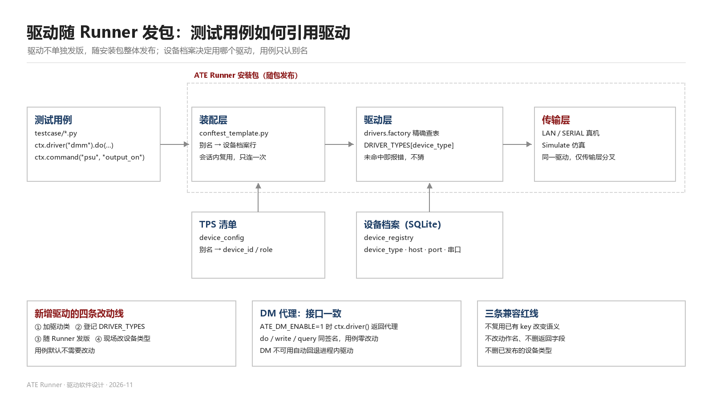

# 驱动随 Runner 发包 —— 测试用例如何引用驱动

**适用对象**：TPS 用例开发人员、现场装备维护人员、Runner 发布人员
**前提**：驱动不单独发版，驱动代码随 ATE Runner 安装包整体发布；现场不做驱动包选择、不做版本比对、不做运行时热插拔。
**与既有文档的关系**：本文在"驱动随包发布"前提下重写用例侧的使用约定。`driver-distribution.md` 描述的在线包索引与版本选择机制在当前形态下不再启用，保留作为后续若要引入独立驱动包分发时的参考。

---

## 1. 三条基本事实

先明确三件事，后文的全部约定都由它们推导而来。

1. **驱动代码在 Runner 安装目录内**，即 `backend/drivers/`。Runner 装好，驱动就在；Runner 升级，驱动跟着换。
2. **设备的"用哪个驱动"记在设备档案上**，字段名 `device_type`，取值必须来自受控清单 `backend/drivers/factory.py::DRIVER_TYPES`。
3. **测试用例只认别名（alias），不认驱动名、不认型号**。用例里出现的永远是 `ctx.driver("dmm")` 这样的调用，而不是某个驱动类名。

由此得到一条对用例开发最重要的结论：**新增驱动、替换驱动实现、把某台设备换成另一款同功能仪器，都不需要改用例代码**，只要设备档案上的 `device_type` 指向的驱动对外动作集合不变。

---

## 2. 运行期各层的位置与职责

| 层 | 物理位置 | 内容 | 谁维护 | 变更方式 |
|---|---|---|---|---|
| 驱动实现 | `backend/drivers/*.py` | 驱动类、动作方法、真机命令拼接、仿真响应 | 驱动开发 | 随 Runner 发版 |
| 设备类型清单 | `drivers/factory.py` 内置清单 + `drivers/discovery.py` 自动发现 | `device_type → 驱动类` 的受控表 | 驱动开发 | 随 Runner 发版；新增驱动只需加模块 |
| 设备档案 | SQLite `device_registry` | 每台设备的 `device_type`、IP、端口、串口、波特率、超时 | 现场装备维护 | 「装备属性配置」界面 |
| 装配层 | `backend/tps_runtime/conftest_template.py` | 读运行环境 → 读设备档案 → 建驱动 → 提供夹具 | 平台 | 随 Runner 发版 |
| 用例 | `testcase/*.py` | 测量逻辑、判定调用 | TPS 开发 | TPS 版本管理 |

一次 `ctx.driver(alias)` 的完整链路：

1. 装配层从运行目录的 `ate_env.json` 取得本轮 `task_id`、`mode`、测试台标识与 SQLite 库路径；
2. 按测试台标识从 `bench_registry` 找到测试台，再从 `device_registry` 取出该台架登记的全部设备行；
3. 按 TPS 清单 `device_config` 里声明的别名，把别名映射到一行具体的设备档案；
4. 取该行的 `device_type`，到 `DRIVER_TYPES` 做一次精确查表，未命中直接报错，不回退到相似驱动；
5. 用该行的连接参数实例化驱动，连接方式由 `interface` 决定（`LAN` 走网口、`SERIAL` 走串口、缺失走仿真）；
6. 实例缓存在会话上下文中，同一别名在同一进程内只建一次。



---

## 3. 用例侧的三类引用方式

### 3.1 推荐：取驱动实例后调动作

适用于需要连续多次操作同一台设备的用例（先设量程、再读值、再改状态）。

```python
def power_on_voltage(ctx, psu_alias="psu", dmm_alias="dmm", voltage=3.3):
    psu = ctx.driver(psu_alias)        # 首次调用建立连接，后续复用
    psu.do("set_voltage", voltage=voltage)
    psu.do("output_on")

    dmm = ctx.driver(dmm_alias)
    out = dmm.do("measure_dc_voltage")  # 统一返回体，见 §5
    return {"VDD": out["value"]}
```

### 3.2 便捷：一步发动作

适用于单次读写、不需要保留实例引用的场景。内部同样走 `ctx.driver()`，只是省掉取实例这一步，并把返回值从统一返回体里取出 `value`，同时写入运行日志。

```python
def read_speed(ctx, spin_alias="spin"):
    return {"RPM": ctx.command(spin_alias, "read_speed")}
```

### 3.3 夹具：`driver` / `ate_devices` / `ate_thresholds`

装配层提供 session 级夹具，签名里直接声明即可注入。

```python
def test_power_on_voltage(driver, ate_thresholds):
    vdd = driver("dmm").do("measure_dc_voltage")["value"]
    cfg = ate_thresholds["TC_VDD"]
    assert cfg["min"] <= vdd <= cfg["max"]
```

夹具清单：

| 夹具 | 含义 |
|---|---|
| `driver` | 等价于 `ctx.driver`，按别名取实例 |
| `ate_ctx` | 本轮运行的上下文（设备、阈值、记录、日志） |
| `ate_devices` | 别名 → 设备档案行（含 `device_type`、IP、端口、型号） |
| `ate_thresholds` | TPS 清单 `testconfig` 子字典 |
| `ate_bench` | 测试台注册信息（编号、序列号、位置） |
| `ate_runner` | 按 `cmd_suit` 条目执行并自动判定记录 |

**夹具是 session 作用域的**。多个用例在同一进程内共享同一批驱动实例，这既是"避免反复重连"的手段，也意味着用例之间不要互相改动设备的全局状态而不复位。

### 3.4 取设备档案与阈值

```python
row = ctx.device("scope")        # {'device_id': 'rh-scope', 'device_type': 'tektronix-mso5', 'host': ..., ...}
limit = ctx.limit("TC_VDD")      # {'label': ..., 'min': ..., 'max': ..., 'unit': ...}
```

边界情况：别名对应的设备未登记时，`ctx.device()` 返回空字典，`ctx.driver()` 抛 `DriverError`。想提前判断，可先 `ctx.device(alias)` 判空。

---

## 4. 别名如何落到具体设备

别名不是驱动名，是 TPS 与"这台台架上的某个位置"之间的契约。TPS 清单的 `device_config` 决定别名的绑定方式，支持三种写法。

```json
"device_config": {
  "scope":   {"device_id": "rh-scope", "note": "回放信号波形观测"},
  "dmm":     {"device_id": "rh-dmm"},
  "psu":     {"role": "psu"},
  "fixture": "rh-fixture"
}
```

| 写法 | 绑定依据 | 适用 |
|---|---|---|
| `{"device_id": "..."}` | 设备编号精确匹配 | 台架布局固定，期望最强的确定性 |
| `{"role": "..."}` / `{"category": ...}` / `{"model": ...}` | 按角色、类别或型号在台架内匹配 | 同一 TPS 要跑到多台同型台架 |
| `"rh-fixture"` | 字符串简写，等价于 `device_id` | 别名即设备编号的简单台架 |

匹配顺序是：先按 `device_id` 精确命中；未命中时再按 `role / category / model` 在台架设备表内查找。两者都落空时，装配层在运行日志中记一条 `[warn] 测试台 ... 中找不到设备`，并在该别名首次被使用时抛错。

**别名命名建议**：按"在台架上的功能位置"命名（`psu`、`dmm`、`scope`、`spin`、`fixture`），不要按品牌或型号命名。一旦写成 `tek_scope`，后续换机就必须改用例，违背了本节开头那条契约。

运行模式（真机 / 仿真）由本轮运行环境统一决定，也可以在别名级别覆盖：

```json
"device_config": {
  "scope": {"device_id": "rh-scope", "mode": "real"},
  "dmm":   {"device_id": "rh-dmm",  "mode": "simulate"}
}
```

未写 `mode` 时继承本轮运行模式。**同一个驱动类同时服务真机与仿真，分叉只在 transport 层**，因此"仿真能跑通"不等于"真机能跑通"，真机命令必须现场验证过。

---

## 5. 动作契约与返回结构

驱动对外只暴露"动作"，不暴露命令串。用例调用 `do(action, **params)`，得到统一返回体：

```json
{
  "ok": true,
  "device_id": "rh-dmm",
  "alias": "dmm",
  "driver": "generic-dmm",
  "action": "measure_dc_voltage",
  "value": 3.312,
  "detail": {"unit": "V"},
  "simulated": true
}
```

约定：

- `value` 是测量值或动作结果，用例做判定时取它；
- `detail` 是附带信息（单位、通道、原始采样数等），不参与判定；
- `simulated` 标明本次结果来自仿真还是真机，**报告与结论必须能区分这两者**；
- 动作失败一律抛 `DriverError`，不返回 `ok: false`，避免用例忘记判空。

`ACTIONS` 是"对外动作名 → 方法名"的映射。未在 `ACTIONS` 中登记的动作名会按同名方法兜底调用，因此**新驱动必须把对外动作列进 `ACTIONS`**：设备档案界面与驱动能力清单都从这里读取，漏登记会导致界面上看不到该动作，但用例直接调用又能跑通——这类不一致很难排查。

内置驱动的动作集合（供对照，新增驱动时保持同类动作命名一致）：

| 设备类型 `key` | 典型动作 |
|---|---|
| `tektronix-mso5` | `idn` `reset` `autoset` `timebase` `channel` `waveform` `measure` `run` `stop` `single` `state` |
| `generic-dmm` | `measure_dc_voltage` `measure_dc_current` `measure_resistance` `measure_frequency` `measure_ac_voltage` |
| `generic-psu` | `set_voltage` `set_current` `output` `output_on` `output_off` `measure_voltage` `measure_current` |
| `generic-eload` | `set_current` `set_mode` `input` `input_on` `input_off` `measure_voltage` `measure_current` |
| `generic-awg` | `set_waveform` `set_frequency` `set_amplitude` `output` `output_on` `output_off` |
| `serial-motion` | `handshake` `set_speed` `read_speed` `home` `stop` |
| `basler-pylon` | `enumerate_devices` `configure` `grab` `snap` `sequence` `stats` `trigger` |
| `passive-device` | 无通信，仅登记信息 |

---

## 6. 新增驱动的落地步骤

先判断是否真的需要新驱动。**能用"通用 SCPI + 动作别名"解决的，不要新增驱动类**：若设备是标准 SCPI 仪器，只是命令串不同，优先在 `generic-scpi` 上补齐动作，避免驱动数量膨胀。

确需新增时，按以下七步推进。

### 第 1 步：实现驱动类

```python
# backend/drivers/power_meter.py
# -*- coding: utf-8 -*-
"""光功率计驱动：波长设置与功率读取"""

from .base import Driver


class PowerMeterDriver(Driver):
    driver_key = "generic-power-meter"
    family = "power"
    label = "光功率计"
    sim_idn = "ATE,SIM-PM,0,1.0.0"

    ACTIONS = {
        "idn": "identify",
        "reset": "reset",
        "state": "state",
        "set_wavelength": "set_wavelength",
        "read_power": "read_power",
    }

    def set_wavelength(self, nm: float = 1310.0, **_):
        if self.simulate:
            return {"value": nm, "unit": "nm"}
        self.write(f":SENS:POW:WAV {nm}NM")
        return {"value": nm, "unit": "nm"}

    def read_power(self, **_):
        if self.simulate:
            return {"value": 1.234, "unit": "mW"}
        return {"value": float(self.query(":READ:POW?")), "unit": "mW"}

    def simulate_command(self, command: str) -> str:
        if "READ:POW" in command.upper():
            return "1.234E-3"
        return super().simulate_command(command)
```

本示例的完整实现已随仓库提供：`backend/drivers/power_meter.py`（含波长范围校验、平均次数、归零与 dBm 换算），可直接作为新增驱动的对照样板。

### 第 2 步：让平台发现这个驱动

把模块放进 `backend/drivers/` 即可，**不需要修改 `factory.py`**。进程启动时 `discovery.scan()` 扫描该目录，把模块内定义的 `Driver` 子类并入受控类型清单。

| 判据 | 要求 |
|---|---|
| 模块位置 | `backend/drivers/<name>.py`，文件名不以 `_` 开头 |
| 类定义 | `Driver` 子类，且定义在该模块内 |
| 必填元数据 | `driver_key`、`family`、`label` |
| 类型描述 | 取类文档首行，显示在「装备属性配置」的下拉说明里 |

发现结果有三种去向：

- 新 `key` → 并入清单，`source` 标为 `discovered`；
- 与内置 `key` 相同 → 内置优先，静默跳过，内置类型不会被驱动文件覆盖；
- 两个可发现模块撞同一个 `key` → 先到者保留，后者记入 `duplicates`，自检随之报 `ok=false`。

`key` 必须全局唯一且不再改动——它会被写入设备档案的 `device_type` 列，改名等于让所有已配好的台架失效。

发布前用自检接口确认清单健康：

```
GET /api/testbench/driver-check
→ {"ok": true,
   "self_check": {"ok": true, "problems": [], "types": 10, "builtin": 9, "discovered": 1},
   "registry": {"builtin": 9, "discovered": 1, "total": 10,
                "duplicates": [], "errors": []}}
```

自检覆盖四类问题：`key` 非法或重复、`family` / `label` 缺失、`ACTIONS` 为空、`ACTIONS` 指向不存在的方法。新增驱动最常犯的正是后两类。

### 第 3 步：补齐仿真分支

仿真是现场排障与离线演示的唯一手段，必须覆盖 `ACTIONS` 全集。仿真返回值要**确定性**：同类设备使用 `stable_ratio()` 生成固定偏差，不要用随机数，否则同一台架每次运行报告的测量值都在跳，无法复现问题。

### 第 4 步：随 Runner 发版

驱动代码进入 Runner 安装包，随 Runner 整体发布。不做独立驱动包、不在现场安装或替换单个文件。发版说明中列出新增的 `device_type` 及其动作集合，供现场配置与 TPS 开发对齐。

### 第 5 步：现场把设备改成新类型

打开「装备属性配置」，选中目标设备，把「设备类型」改为新 `key`。下拉列表来自 `GET /api/testbench/device-types`，即第 2 步登记的受控清单，安装新 Runner 后自动出现，无需手工填表。

改完必须做一次台架校验，确认连接参数、`interface`、超时与设备实际一致。

### 第 6 步：用例侧确认

绝大多数情况下**用例不改**。需要改动的情形只有三类：

| 情形 | 是否需要改用例 | 处理 |
|---|---|---|
| 设备换了品牌/型号，功能与动作名不变 | 否 | 只改设备档案的 `device_type` |
| 新驱动提供了更强能力，用例想用新动作 | 是 | 用例中增加 `ctx.command(alias, "新动作", ...)` |
| 新驱动的动作名与旧驱动不一致 | 是（不推荐） | 优先在驱动内做动作别名，保持对外动作集合不变 |

### 第 7 步：把新增动作纳入 TPS 判定

若新动作的输出需要参与判限，在 TPS 清单 `testconfig` 中补阈值项，并在 `cmd_suit` 条目的 `checks` 中建立"返回字段 → 阈值键"的映射。阈值键与动作名解耦，便于同一阈值被多条用例复用。

---

## 7. 兼容红线

新增或修改驱动时，以下四条不可触碰。触碰任何一条，都会让现场已发布的 TPS 在升级 Runner 后失败。

1. **不复用已有 `key` 改变语义**。需要不同行为就新增 `key`，不要在原 `key` 上悄悄换实现。
2. **不改已有动作名**。动作名是对外契约，用例与前端都按名字调用。
3. **不改已有返回字段名**。`value` / `detail` 的结构可以增字段，不可删字段、不可改含义。
4. **不删已有设备类型**。即使某款仪器停产，也保留其驱动，否则引用它的台架在升级后无法启动。

确需废弃时，采用"标记废弃 + 保留实现"的方式，在 `DRIVER_TYPES` 的 `description` 中注明替代类型，至少保留一个大版本周期。

---

## 8. 与装备管理模块（DM）的关系

Runner 启用装备管理模块后（`ATE_DM_ENABLE=1`），设备连接由 DM 进程持有，用例拿到的是 DM 代理对象，而不是进程内驱动实例。

对用例的影响：**没有影响**。代理对象实现了与驱动一致的接口——`do()`、`write()`、`read()`、`query()`、`state()`、`identify()`、`close()`，以及 `device_id`、`alias`、`resource`、`simulate` 属性。因此 §3 的三种写法在两种接入方式下完全通用。

差异只有两处：

| 差异 | 进程内驱动 | DM 代理 |
|---|---|---|
| 连接归属 | 用例进程 | DM 进程，跨用例复用 |
| 大数据吞吐 | 返回完整数据 | 可用 `stream()` 走共享内存环 |
| 故障处理 | 直接抛 `DriverError` | DM 不可用时自动回退进程内驱动，日志记 `[warn] 装备管理模块不可用，回退进程内驱动` |

回退是**有意的**：设备管理模块的可用性不得影响测试结论。现场看到该 `[warn]` 说明 DM 未能拉起或管道不通，应排查 DM 状态，但本轮测试结果仍然有效。

---

## 9. 排查对照表

| 现象 | 原因 | 处理 |
|---|---|---|
| `设备未指定 device_type，请在测试台注册时选择设备类型` | 设备档案缺 `device_type` | 在「装备属性配置」补选设备类型 |
| `未知设备类型: xxx`，并列出可选类型 | 档案里的 `device_type` 不在受控清单内，通常是 Runner 版本与档案不匹配 | 确认 Runner 版本已包含该驱动；或改回清单内的类型 |
| `无法为 xxx 建立驱动: 测试台 ... 中找不到设备` | TPS 的 `device_config` 别名绑定的 `device_id`/`role` 在该台架不存在 | 核对 TPS 别名与台架设备登记 |
| `驱动 xxx 不支持动作: yyy`，并列出可用动作 | 动作名拼写错误，或该驱动未实现 | 按提示改用可用动作；确需新动作则新增驱动方法并登记 `ACTIONS` |
| 连接超时 / 拒绝连接 | IP、端口、串口参数与设备实际不符，或设备未上电 | 用台架校验功能逐台验证连通性 |
| 仿真通过、真机失败 | 真机命令未现场验证，或型号命令集不同 | 真机逐动作验证，必要时按型号分驱动 |
| 同一台设备报"被占用" | 多个进程同时持有同一设备连接 | 启用 DM 由单进程持有连接 |

---

## 10. 发布前自检清单

驱动开发侧：

- [ ] `key` 唯一，且与既有类型不冲突
- [ ] `ACTIONS` 覆盖全部对外动作，动作名与同类设备保持一致
- [ ] 每个动作都有仿真分支，仿真值确定可复现
- [ ] 真机分支已在真实设备上逐动作验证
- [ ] `interface` 与设备实际连接方式一致，串口参数完整
- [ ] 会话结束时有安全收尾（如电源输出关闭），通过 `on_close()` 登记
- [ ] 驱动模块已放入 `drivers/`，`GET /api/testbench/device-types` 返回该项且 `source=discovered`
- [ ] `GET /api/testbench/driver-check` 返回 `ok=true`，`problems` 与 `duplicates` 均为空

现场侧：

- [ ] 设备档案的 `device_type` 已改为新类型
- [ ] 台架校验通过，连接参数字段无空缺
- [ ] 至少一条既有用例在真机模式下跑通
- [ ] 运行日志中出现 `驱动就绪 ... [真机]`，而非 `[仿真]`

TPS 侧：

- [ ] 用例只使用别名，未出现驱动类名或型号
- [ ] 新增动作已在 `checks` 中建立阈值映射
- [ ] 仿真与真机两种模式下结论一致（或差异已记录并解释）

---

## 11. 一句话记忆

**驱动住在 Runner 里，设备档案决定用哪个，用例只喊别名。**
新增驱动是"加一个类 + 登一张表 + 发一次包 + 改一次档案"，用例默认不需要动。

---

## 附录：与 SDK 型号派发层的区别

仓库内存在两套按型号/类型派发的机制，职责不同，不要混用。

| 维度 | Runner 驱动层 `backend/drivers/` | SDK 驱动层 `sdk/ate_drivers/` |
|---|---|---|
| 派发依据 | 设备档案的 `device_type` | 设备档案的 `model`（型号） |
| 面向对象 | TPS 用例、Runner 内的工具与助手 | 外部脚本、独立工具、SDK 使用者 |
| 清单形式 | Python 常量 `DRIVER_TYPES` | 每包一份 `driver.json` |
| 接入方式 | `drivers.get_driver()` | `factory.open_scope()` / 相机的 `camera_factory` |
| 发布方式 | 随 Runner 安装包 | 随 SDK 发布 |

对 TPS 用例而言，只需要 Runner 驱动层。SDK 层用于脱离 Runner 运行的独立程序，两者不共享实例，也不应在同一进程内混用同一台设备。
